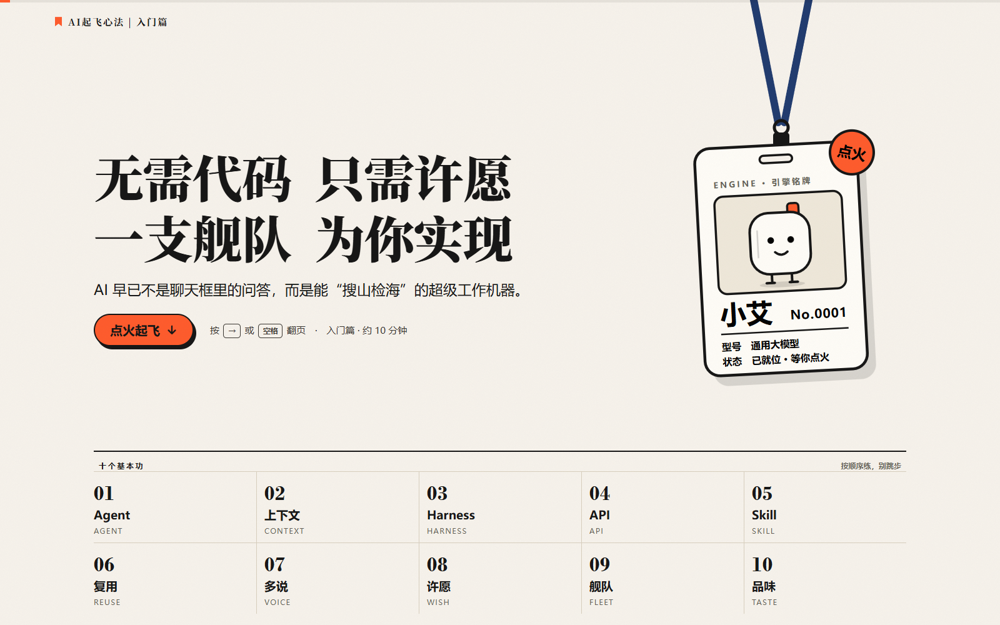
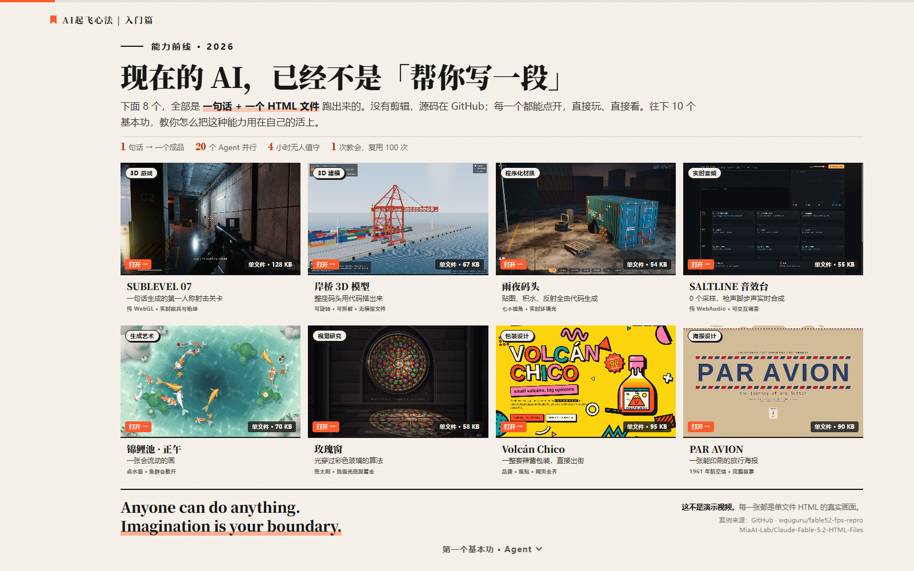
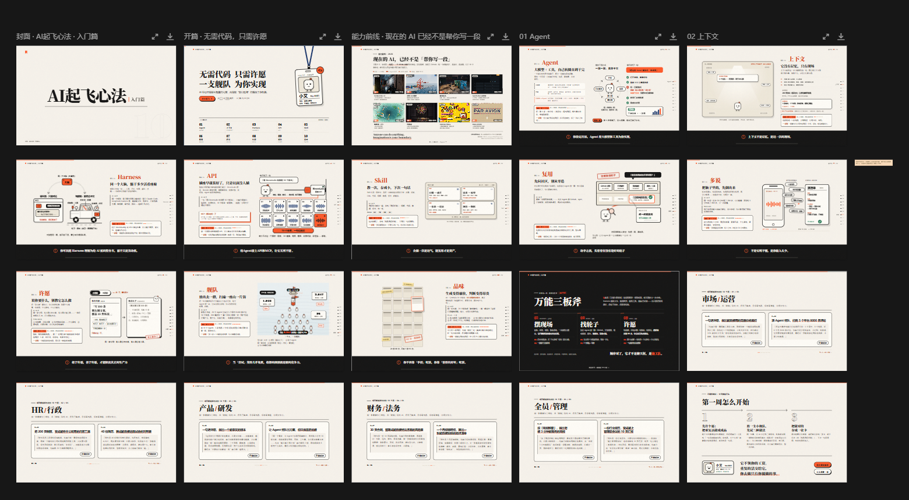

# AI起飞心法 · 10 个基本功

给不写代码的同事看的 AI 实用入门。

不先讲 Agent、Harness、API 这些词。先看 8 个「一句话跑出来的成品」，再用 10 个基本功把「AI 能帮我干什么」讲到能上手，最后带走一张能直接派活的许愿模板。

> 一句话：AI 不是聊天框里的玩具，是一支能替你干活的施工队。

在线看：[案例画廊](https://zirumyg.github.io/ai-flight-handbook/cases/) · [仓库主页](https://zirumyg.github.io/ai-flight-handbook/)

## 8 个案例：一句话，一个 HTML

每个都是单文件 HTML。点开就能玩，不需要安装、不需要构建。

| 案例 | 类型 | 一句话 | 文件 |
|---|---|---|---|
| **SUBLEVEL 07** | 3D 游戏 | 一句话生成的第一人称射击关卡；纯 WebGL，实时弹道与枪械动画 | [打开](cases/04-sublevel-07.html) |
| **岸桥 3D 模型** | 3D 建模 | 整座码头用代码搭出来；可旋转、可拆解，没有一个模型文件 | [打开](cases/03-port-crane.html) |
| **雨夜码头** | 程序化材质 | 贴图、积水、反射全由代码生成；可切换七种材质 | [打开](cases/02-rainy-dock.html) |
| **SALTLINE 音效台** | 实时音频 | 0 采样，枪声、弹壳、脚步全是实时合成；纯 WebAudio | [打开](cases/01-saltline-audio.html) |
| **锦鲤池 · 正午** | 生成艺术 | 一张会流动的画；点水面，鱼群会散开 | [打开](cases/09-koi-pond-noon.html) |
| **玫瑰窗** | 视觉研究 | 光穿过彩色玻璃的算法；拖太阳，地面光斑跟着走 | [打开](cases/30-rose-window.html) |
| **Volcán Chico** | 包装设计 | 一整套辣酱包装，直接出街；品牌、瓶贴、网页全齐 | [打开](cases/06-volcan-chico.html) |
| **PAR AVION** | 海报设计 | 一张能印刷的旅行海报；1961 年航空信，完整叙事 | [打开](cases/64-par-avion.html) |

也可以直接进 [案例画廊](cases/index.html) 一次看全。

> 前三个 3D 案例首次打开需要联网加载 Three.js；其余五个完全离线可开。

## 10 个基本功

| # | 基本功 | 一句话 |
|---|---|---|
| 01 | **Agent** | 大模型 + 工具，给个目标，它自己转圈直到干完 |
| 02 | **上下文** | 它没有记忆，只有这一次的现场；你喂什么，它才能看见什么 |
| 03 | **Harness** | 同一个大脑，能干多少活看座舱 |
| 04 | **API** | 插座早就装好了，只是以前没人插；Agent 就是那个会插电的 |
| 05 | **Skill** | 教一次，存成卡，下次一句话 |
| 06 | **复用** | 先问社区，别从零造 |
| 07 | **多说** | 打字是漏斗，说话是倒水；把脑子里的先倒出来 |
| 08 | **许愿** | 说你要什么，别教它怎么做 |
| 09 | **舰队** | 放出去一群，扫遍一座山一片海 |
| 10 | **品味** | 生成变得廉价，判断变得昂贵 |

## 20 屏画布

| 屏 | 页面 | 文件 |
|---|---|---|
| 01 | 封面 | project/cover.dc.html |
| 02 | 开篇：无需代码，只需许愿 | project/Main.dc.html |
| 03 | 能力前线：8 个单文件案例 | project/front.dc.html |
| 04 | 01 Agent | project/ch01-agent.dc.html |
| 05 | 02 上下文 | project/ch02-context.dc.html |
| 06 | 03 Harness | project/ch05-harness.dc.html |
| 07 | 04 API | project/ch06-api.dc.html |
| 08 | 05 Skill | project/ch08-skill.dc.html |
| 09 | 06 复用 | project/ch09-reuse.dc.html |
| 10 | 07 多说 | project/ch09b-talk.dc.html |
| 11 | 08 许愿 | project/ch09-wish.dc.html |
| 12 | 09 舰队 | project/ch10-fleet.dc.html |
| 13 | 10 品味 | project/ch11-taste.dc.html |
| 14 | 万能三板斧 | project/tpl.dc.html |
| 15 | 10 个活 · 市场 / 运营 | project/jobs1-market.dc.html |
| 16 | 10 个活 · HR / 行政 | project/jobs2-hr.dc.html |
| 17 | 10 个活 · 产品 / 研发 | project/jobs3-product.dc.html |
| 18 | 10 个活 · 财务 / 法务 | project/jobs4-finance.dc.html |
| 19 | 10 个活 · 全员 / 管理 | project/jobs5-all.dc.html |
| 20 | 第一周怎么开始 | project/week.dc.html |

## 预览

## 仓库结构

    cases/               # 8 个单文件案例 + 案例画廊 index.html
    project/
      canvas.json        # 20 屏画布布局
      *.dc.html          # 每屏一个 HTML
      assets/            # 页面用到的图片、纹理与字体素材
    preview/             # 封面 / 开篇 / 能力前线 / 总览截图
    README.md

## 打开方式

这是 claude-design 画布工程，不是传统静态站点。

- 只想看效果：直接看 preview/ 里的截图。
- 想玩案例：打开 cases/index.html，或直接点开 cases/ 里的单个 HTML。
- 想继续编辑：用支持 claude-design 画布格式的编辑器打开本目录；编辑器读取 project/canvas.json 后会按 5 列 × 4 行排成 20 屏。
- 想改其中一屏：改 project/ 下对应的 .dc.html。
- history/、服务日志等本机缓存不会进入仓库。

## 制作说明

- 初版 10 章、8 个单文件案例页：Claude Code + Fable 5.2。
- 10 章重构、章节合并、画布重排、案例画廊整理：DSH Agent。
- 页面里出现的品牌名、价格、SKU、日期均为演示数据。
- 案例为公开 Fable 5.2 单文件实验的整理版本，仅作能力展示。

## 说明

这是内部培训材料的公开版本，未附开源许可证。代码可自由阅读；转载、商用或再分发请先联系作者。
